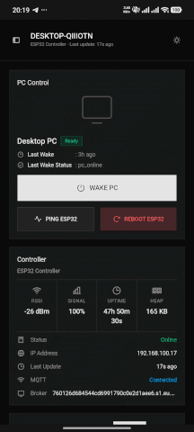
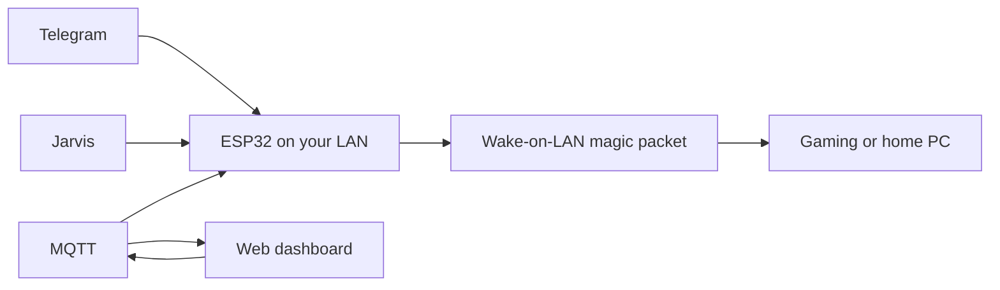

# ESP32 Wake-on-LAN Remote

[](LICENSE)
[](https://www.espressif.com/)
[](https://core.telegram.org/bots)
[](dashboard/README.md)

**Turn on your gaming or home PC from Telegram, MQTT, or a private web dashboard — without port forwarding or a cloud subscription.**

An ESP32 stays on your home network and sends a Wake-on-LAN magic packet to your PC. Wake it by saying “Jarvis” followed by “wake,” or control it remotely through Telegram, MQTT automation, or the included browser dashboard.



## Why this exists

Useful for gaming PCs, Moonlight/Sunshine streaming, home labs, and desktops that normally stay powered off. Send `/wake` from Telegram, press **WAKE PC** in the dashboard, or publish an MQTT command. The ESP32 handles the local network part.

## How it works



The ESP32 must remain connected to your local network. Telegram and MQTT provide the remote control path; the PC does not need a public IP or port forwarding.

## What it does

- **Wake your PC by voice** by saying “Jarvis,” then “wake”; Telegram and MQTT keep their confirmation and force options
- **Wake your PC remotely** with a confirmation step or immediate force mode
- **Check PC status** with a TCP probe
- **Diagnose the ESP32** with reset reason, heap, WiFi RSSI, uptime, and poll health
- **Recover automatically** with a watchdog and WiFi reconnect backoff
- **Control through MQTT** with TLS, retained state, replies, and events
- **Use the private web dashboard** over MQTT WebSocket
- **Send important health events to Grafana Cloud Loki** optionally

## Voice wake

Say **“Jarvis”** to open a blue command-listening window. Within ESP_SR's built-in approximately 5.76-second MultiNet timeout, say **“wake”** for local WoL or one of the configured media phrases: “play”, “pause”, “next”, “back”, “mute”, or “unmute”. “Jarvis” alone never sends a command. Each window accepts at most one command; timeout returns to wake-word listening. The RGB LED is blue while listening and identifies submitted WoL packets: voice green, MQTT cyan, Telegram purple; red indicates WoL submission failure. Media feedback uses dim 500-ms pulses: yellow queued/accepted, white only for a correlated execution acknowledgement, red for rejection/failure/unknown. These signals do not prove playback state. The microphone uses BCLK GPIO5, WS GPIO6, and DATA GPIO4. The Jarvis model is included in the normal USB flash image; see the [Jarvis wake-word guide](docs/jarvis-wake-word.md).

**Media-control status:** The repository now includes a Windows 11 x64 HTTPS tray daemon under [`daemon/`](daemon/), plus the ESP contract and localhost-first setup guide. The firmware's yellow “accepted” response still means only request acceptance; white execution feedback is available only when a real Windows daemon reports the correlated command. Windows runtime, ESP/LAN interoperability, and gaming-performance validation remain pending; the non-actioning fixture never executes media. See the [Windows daemon guide](docs/windows-media-daemon.md) and [HTTPS contract](docs/media-control-https.md).

## Quickstart: Telegram

This is the simplest way to verify the project works.

### You need

- ESP32-S3-DevKitC-1 N16R8 with the I2S microphone connected to BCLK GPIO5, WS GPIO6, and DATA GPIO4
- A PC with Wake-on-LAN enabled in BIOS, the OS, and the network adapter
- WiFi access for the ESP32
- [PlatformIO Core](https://docs.platformio.org/en/latest/core/installation/index.html)
- A Telegram bot token from [@BotFather](https://t.me/BotFather)

First, enable and test Wake-on-LAN on the PC using the [Wake-on-LAN setup guide](docs/wake-on-lan.md). If the PC cannot wake from another WoL tool, the ESP32 cannot fix it.

### Build and flash

```bash
cp config.example.h config.h
# Set WIFI_SSID, WIFI_PASS, PC_MAC, and WOL_BCAST in config.h.
# Set PC_IP and PC_TCP_PORT if you want PC status polling.
# BOT_TOKEN and MQTT settings are optional.

pio run
pio run -t upload --upload-port /dev/ttyACM0
pio device monitor --port /dev/ttyACM0 --baud 115200
```

Replace `/dev/ttyACM0` with your board's serial port. `pio run` downloads the pinned platform and declared libraries. Voice wake works without Telegram or MQTT configuration; those remote-control services remain optional.

After flashing, open your bot in Telegram and send `/help`, then `/wake`. The bot asks for confirmation before sending the packet. For voice testing, say “Jarvis,” then “wake” within the listening window; confirm the Serial Monitor reports packet submission. The LED color identifies the source of a submitted packet, not that the PC is online.

See [Telegram bot setup](docs/telegram.md) for the complete guide. See [LAN app-firmware OTA](docs/ota.md) for credential setup, upload, and recovery instructions.

## Hardware validation

- Confirm Serial prints `[voice] listening for Jarvis` after successful microphone/ESP_SR initialization.
- Say “Jarvis”; verify a blue listening indication and no WoL packet yet.
- Say “wake” within about 5.76 seconds; verify one WoL submission and a green RGB flash lasting about 500 ms.
- Let a listening window time out; verify the LED turns off, wake-word mode resumes, and no packet is sent.
- Start a new session immediately after command completion; verify another command is accepted without a five-second cooldown.
- Disconnect Wi-Fi, say “Jarvis” and “wake”; verify a red flash and no delayed WoL after reconnecting.
- Submit a confirmed Telegram wake and an MQTT wake; verify a purple Telegram flash and cyan MQTT flash, each lasting about 500 ms.
- Verify a request waiting for confirmation does not flash a submission color.
- Check voice logs distinguish listening start/timeout, media queued/accepted/rejected/unknown, and WoL packet submission; verify Telegram and MQTT/dashboard controls still work.
- With disposable settings and the LAN HTTPS test fixture, try all six media phrases; verify one matching accepted request/yellow pulse per session. Stop the fixture or use an untrusted certificate; verify red feedback and no retry after reconnect. The fixture does not execute media, so white execution feedback awaits the Windows daemon.

## Telegram commands

| Command             | What it does                            |
| ------------------- | --------------------------------------- |
| `/help` or `/start` | Show the command menu                   |
| `/ping`             | Show ESP32 diagnostics                  |
| `/status`           | Show ESP32 health and PC online status  |
| `/wake`             | Request wake confirmation               |
| `/wake force`       | Send the Wake-on-LAN packet immediately |
| `/reboot`           | Reboot the ESP32                        |

Leave `BOT_TOKEN` blank to disable Telegram; voice wake remains available, and MQTT can be configured independently.

## MQTT control

MQTT is optional. Configure these values in `config.h` to enable MQTT over TLS, normally on port `8883`:

- `MQTT_BROKER`
- `MQTT_PORT`
- `MQTT_USER`
- `MQTT_PASS`
- `MQTT_BASE_TOPIC` (for example, `home/pc-remote/desktop-01`)

The PlatformIO configuration installs the MQTT library automatically; leave the broker settings blank to disable MQTT.

Topics under `MQTT_BASE_TOPIC`:

| Topic           | Retain | Purpose                    |
| --------------- | ------ | -------------------------- |
| `/availability` | Yes    | ESP32 online/offline state |
| `/state`        | Yes    | Latest ESP32 and PC status |
| `/cmd`          | No     | Action commands            |
| `/reply`        | No     | Command replies            |
| `/event`        | No     | One-time events            |
| `/log`          | No     | Live debug logs            |

Commands on `/cmd`:

```text
ping
wake_request
wake_confirm
reboot_request
reboot_confirm
```

`wake_request` accepts `force: true` to skip confirmation. `/state` is refreshed when values change and every 60 seconds, and includes `pc_online` and `pc_status`.

Example wake request:

```json
{
  "id": "wake-001",
  "cmd": "wake_request",
  "target": "desktop-pc",
  "force": true,
  "expires_in_s": 30,
  "ts": 1783586658
}
```

If Telegram and MQTT are both configured, both control paths remain available.

## Private web dashboard

The `dashboard/` directory contains a React + Vite + TypeScript browser dashboard for MQTT control.

- **Transport:** MQTT over WebSocket
- **Deploy:** Cloudflare Pages
- **Private access:** Cloudflare Access with GitHub login
- **Features:** wake confirmation, PC status, ESP32 health, MQTT replies, events, and logs

Run locally:

```bash
cd dashboard
cp .env.example .env
bun install
bun run dev
```

Build for deployment:

```bash
bun run build
```

See the [dashboard setup guide](dashboard/README.md) for Cloudflare Pages, Access, environment variables, and MQTT ACLs.

> **Security:** Dashboard `VITE_*` credentials are embedded in the browser bundle and can be inspected by anyone who can access the site. Use Cloudflare Access and a dedicated MQTT user with restricted topic ACLs.

## Configuration

Copy `config.example.h` to `config.h` and fill in the values for your setup:

```c
#define WIFI_SSID     "your-wifi-ssid"
#define WIFI_PASS     "your-wifi-password"
#define BOT_TOKEN     ""                    // optional Telegram token
#define PC_NAME       "gaming-pc"
#define PC_MAC        "aa:bb:cc:dd:ee:ff"
#define PC_IP         "192.168.1.50"
#define WOL_BCAST     "192.168.1.255"
#define WOL_PORT      9
#define PC_TCP_PORT   47989                 // Moonlight, SSH, SMB, etc.
```

Use a static IP or DHCP reservation for the PC so the ESP32 can reliably check its status. Optional LAN media control uses `PC_MEDIA_HOST`, `PC_MEDIA_PORT`, `PC_MEDIA_CA_CERT`, and `PC_MEDIA_API_TOKEN`; see the [HTTPS contract and test setup](docs/media-control-https.md). Leave `PC_MEDIA_HOST` blank to disable it. Never commit `config.h` or use production tokens in tests.

## Requirements and limitations

- ESP32-S3-DevKitC-1 N16R8 and the supported I2S microphone wiring listed above
- PlatformIO Core; the PlatformIO project pins the pioarduino platform and Arduino-ESP32 version
- Wake-on-LAN must work from the same LAN before using this project
- The ESP32 needs power and WiFi while the PC is off
- The dashboard requires an MQTT broker with WebSocket support

## Troubleshooting

**PC will not wake**

- Verify WoL in BIOS and the OS/network adapter settings
- Disable ErP / ErP-ready if it removes power from the NIC
- Test the PC with another WoL tool first
- Confirm `PC_MAC` and `WOL_BCAST` are correct

**ESP32 keeps rebooting**

- Check `/ping` for the reset reason
- `task_wdt` means the main loop hung and the watchdog recovered it
- `brownout` usually means the power supply is too weak

**Telegram bot does not respond**

- Confirm `BOT_TOKEN` matches the token from BotFather
- Check that the ESP32 has WiFi
- Wait a few seconds after boot for Telegram polling to start

**MQTT does not connect**

- Check broker, port, username, password, and base topic
- Confirm the broker accepts TLS on port `8883`
- For the dashboard, confirm the broker supports MQTT over WebSocket

## Optional Grafana Cloud logging

Send boot, WiFi, and watchdog events to Grafana Cloud Loki:

1. Create a [Grafana Cloud](https://grafana.com) account
2. Fill in `GRAFANA_LOGS_URL`, `GRAFANA_LOGS_USER`, and `GRAFANA_LOGS_TOKEN` in `config.h`
3. Leave them blank to disable logging

Logs use the stream `{app="esp32-pc-remote"}`. See the [Grafana setup guide](docs/grafana.md).

## Contributing

Issues and pull requests are welcome. Keep `config.h` out of commits. See [CONTRIBUTING](CONTRIBUTING.md).

## License

MIT

If this project helps you, consider [starring the repository](https://github.com/Jonathan0823/esp32-pc-remote). ⭐
