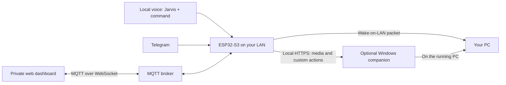

# ESP32 PC Remote

[](LICENSE)
[](https://www.espressif.com/)
[](docs/telegram.md)
[](dashboard/README.md)

**Wake your PC with “Jarvis,” Telegram, or MQTT. Add a private dashboard for MQTT wake control, and an optional Windows companion for voice-triggered media and custom actions.**

An ESP32-S3 stays powered on your home network while your PC is off. It recognizes voice commands locally and sends Wake-on-LAN packets to your PC. Telegram, MQTT, and the web dashboard can wake the PC and show status; they do **not** control Windows media or launch scripts. Those actions are available by voice through the separately paired Windows companion.

Useful for gaming PCs, Moonlight/Sunshine streaming, home labs, and desktops you do not want to leave running all day. No inbound internet port forwarding is needed.

[Previews](#see-it-in-action) · [Quickstart](#quickstart-wake-your-pc-by-voice) · [Optional setup](#optional-setup) · [Commands](#everyday-commands) · [Troubleshooting](#troubleshooting) · [Documentation](#documentation)

## See it in action

### Web dashboard

Wake your PC and view status over MQTT.


### Windows companion

Media and custom voice actions, configured in the Windows app.

> **Screenshot coming soon:** the Actions tab with an example application and its spoken phrase.

<!-- Replace the screenshot placeholder with docs/assets/windows-companion.png. Hide tokens and personal paths. -->

### Voice demo

“Jarvis” → blue listening LED → spoken command → PC wakes or a configured Windows action runs.

> **Video coming soon:** a short recording with audio and captions showing the ESP32 and the actual result on the PC.

<!-- Replace the video placeholder with a link to docs/assets/voice-demo.mp4 or an uploaded GitHub video. Label any skipped PC boot time. -->

## What you can do

| Feature | What you need |
| --- | --- |
| Say “Jarvis,” then “wake” to send a Wake-on-LAN request to your PC | ESP32-S3, I2S microphone, WiFi, and a WoL-capable PC |
| Wake and check your PC through Telegram | A Telegram bot token and internet access |
| Wake your PC and view status through MQTT | An MQTT broker and credentials |
| Wake your PC and view status in the private dashboard | MQTT with secure WebSocket support; access control for a hosted dashboard |
| Control media or run configured apps/scripts by voice | The optional Windows 11 x64 companion, running and paired over your LAN; voice only |
| Monitor ESP32 health | Serial Monitor, Telegram, or MQTT/dashboard; optional Grafana Cloud logging |

**Start with voice wake.** Telegram, MQTT, the dashboard, the Windows companion, and Grafana are optional. Speech recognition runs on the ESP32; it does not need a cloud speech service. Telegram and any remotely hosted services still need network connectivity.

### Lightweight Windows companion

- About **2.7 MB RAM**, with lower usage observed at idle
- **0% CPU at idle**, with no observed CPU spikes while handling media requests or launching configured scripts
- No noticeable gaming-performance impact in manual testing
- Windows app features, media commands, and configured actions tested over the ESP32-to-Windows LAN connection

**TL;DR:** Tested on two Windows machines—a laptop and a desktop PC. These are observed results, not guarantees for every system.

## How it works



The ESP32 must have power and WiFi while the PC is off. The Windows companion is **not required for Wake-on-LAN** and cannot run actions while the PC is off.

## Quickstart: wake your PC by voice

### 1. Prepare the hardware and PC

You need:

- **ESP32-S3-DevKitC-1 N16R8** (16 MB flash, 8 MB PSRAM), a USB data cable, and reliable power
- An I2S microphone compatible with the firmware's 16 kHz, 32-bit, left-channel input
- WiFi access on the PC's LAN
- A PC with Wake-on-LAN enabled in its BIOS, OS, and network adapter
- [PlatformIO Core](https://docs.platformio.org/en/latest/core/installation/index.html) on the computer used to flash the board

Connect the microphone with power disconnected:

| Microphone connection | ESP32-S3 connection |
| --- | --- |
| BCLK / SCK | GPIO5 |
| WS / LRCLK | GPIO6 |
| DATA / SD (microphone output) | GPIO4 |
| GND | GND |

Use your microphone's datasheet for its supply voltage and left-channel selection wiring; the repository does not specify an exact microphone module. Do not connect a 5 V signal to an ESP32 GPIO.

**Test Wake-on-LAN with another tool first.** Follow the [PC Wake-on-LAN setup guide](docs/wake-on-lan.md); if the PC cannot wake from another device on the LAN, fix that before configuring the ESP32.

### 2. Download and configure

```bash
git clone https://github.com/Jonathan0823/esp32-pc-remote.git
cd esp32-pc-remote
cp config.example.h config.h
```

On Windows, use `Copy-Item config.example.h config.h` in PowerShell instead of `cp`.

Edit `config.h`:

| Setting | Value |
| --- | --- |
| `WIFI_SSID`, `WIFI_PASS` | Your home WiFi credentials |
| `PC_MAC` | MAC address of the PC's WoL-enabled network adapter |
| `WOL_BCAST` | Your LAN broadcast address, for example `192.168.1.255` for a `192.168.1.0/24` network |
| `PC_NAME` | Optional display name for the PC |
| `PC_IP`, `PC_TCP_PORT` | For status checks: a reserved PC IP and a TCP port that is actually open while the PC is running |

Leave `BOT_TOKEN`, MQTT, `PC_MEDIA_HOST`, OTA, and Grafana settings blank for this first test. Keep `WOL_PORT` at its default of `9` unless your setup needs another port. `config.h` is ignored by Git; never share it or a firmware image containing your credentials.

### 3. Build and flash over USB

Run these commands from the repository root:

```bash
pio run
pio run -t upload --upload-port /dev/ttyACM0
pio device monitor --port /dev/ttyACM0 --baud 115200
```

Replace `/dev/ttyACM0` with your board's serial port, such as `COM3` on Windows. Use `pio device list` to find it. PlatformIO downloads the pinned platform and declared libraries during the build.

The normal USB upload includes the Jarvis speech models. App-only [LAN OTA](docs/ota.md) is available after provisioning, but does not update those models.

### 4. Try your first wake

1. Check Serial Monitor for `[voice] listening for Jarvis`.
2. With the PC in a WoL-supported sleep/off state, say **“Jarvis.”** The LED turns blue; no command is sent yet.
3. Say **“wake”** within about six seconds. A green flash means the ESP32 submitted the WoL packet.
4. Verify that the PC actually wakes. Packet submission alone does not prove the PC is online.

Each listening window accepts one command. If it times out, say “Jarvis” again. See the [Jarvis guide](docs/jarvis-wake-word.md) for model and recognition details.

## Optional setup

Changes to `config.h` require rebuilding and uploading the firmware.

### Telegram: remote wake and status

Create a bot with [@BotFather](https://t.me/BotFather), set `BOT_TOKEN` in `config.h`, then rebuild and upload. Open your bot and send `/help`, then `/wake`; confirm the request to send the packet.

[Telegram setup guide →](docs/telegram.md)

### MQTT and private web dashboard

Configure `MQTT_BROKER`, `MQTT_PORT`, `MQTT_USER`, `MQTT_PASS`, and `MQTT_BASE_TOPIC` in `config.h`, then rebuild and upload. The dashboard connects to the same broker using MQTT over secure WebSocket; its base topic must match the firmware's.

The dashboard provides wake confirmation, PC status, ESP32 diagnostics, events, replies, and logs. It does not control Windows media or run configured apps/scripts. Those actions are voice-triggered through the paired Windows companion. You can run the dashboard locally or deploy it to Cloudflare Pages with Cloudflare Access. Telegram and MQTT can both remain enabled.

[MQTT setup and command reference →](docs/mqtt.md) · [Dashboard setup and deployment →](dashboard/README.md)

### Windows companion: voice-triggered media and custom actions

The optional Windows 11 x64 tray app in [`daemon/`](daemon/) handles media commands and locally configured application, Batch, and PowerShell actions **when invoked by voice through the ESP32**. Telegram, MQTT, and the dashboard cannot trigger these actions. Its listener starts paused and bound to localhost; LAN pairing is an explicit setup step.

Follow the guide to install a CI build or build locally, choose a reserved private LAN IP, export the public CA certificate, and copy the pairing token into `config.h`. Rebuild/upload the ESP firmware and allow only the necessary private-LAN firewall access. Never forward the companion's port to the internet or disable TLS verification.

For custom phrases: configure an action, assign its phrase, select **Save phrases**, then **Apply to ESP**, and say **“Jarvis,” then “update.”** Later phrase changes do not require reflashing. Up to 12 custom phrases are supported; see the guide for phrase rules.

[Windows installation and setup →](docs/windows-media-daemon.md) · [LAN pairing steps →](docs/windows-media-daemon.md#pair-an-esp32-over-the-lan)

### Grafana Cloud logging

Optionally send boot, WiFi, and watchdog events to Grafana Cloud Loki. Set `GRAFANA_LOGS_URL`, `GRAFANA_LOGS_USER`, and `GRAFANA_LOGS_TOKEN` in `config.h`; leave them blank to disable logging.

[Grafana setup guide →](docs/grafana.md)

## Everyday commands

Say **“Jarvis” first**, then one command:

| Voice command | Result |
| --- | --- |
| `wake` | Submit a local Wake-on-LAN packet; no Windows companion needed |
| `play` or `pause` | Toggle playback through the Windows companion; both currently send the same play/pause key |
| `next` / `back` | Send next-track / previous-track media keys |
| `mute` / `unmute` | Mute / unmute the Windows default audio endpoint |
| `update` | Fetch and activate published custom phrases from the paired Windows companion |
| Your configured phrase | Request the associated enabled Windows action |

Telegram commands, when configured:

| Command | Result |
| --- | --- |
| `/help` or `/start` | Show the menu |
| `/ping` | Show ESP32 diagnostics |
| `/status` | Show ESP32 health and PC status |
| `/wake` | Request wake confirmation |
| `/wake force` | Send a WoL packet immediately |
| `/reboot` | Reboot the ESP32 |

**LED feedback:** blue means listening. Green (voice), cyan (MQTT), or purple (Telegram) means a WoL packet was submitted. For media/custom actions, yellow means queued/accepted; white means Windows reported issuing the action, not that playback or the desired result occurred. Red means failure, rejection, or an unconfirmed outcome; it does not prove a Windows action did not occur.

## Limitations and security

- **Hardware support:** the firmware targets the ESP32-S3-DevKitC-1 N16R8, not every ESP32 board. Recognition quality depends on the microphone, placement, and noise.
- **PC status is a TCP probe:** use a DHCP reservation and an open service port. A failed probe does not necessarily mean the PC is powered off.
- **Keep credentials private:** do not commit `config.h`, dashboard `.env`, pairing tokens, or TLS private keys. Firmware and dashboard bundles can contain credentials.
- **Protect the dashboard:** `VITE_*` values are visible in the browser bundle. Use access control such as Cloudflare Access and a separate MQTT user with restricted topic ACLs.
- **Know the current TLS limitation:** the firmware's Telegram and MQTT clients use TLS but disable server-certificate verification. Do not assume they authenticate the remote server. The Windows media connection uses a paired CA and verifies the server.
- **Trust configured actions:** Windows applications/scripts run as the logged-in user, not in a sandbox. An uncertain media/action request is not automatically retried or queued for later execution.

## Troubleshooting

| Problem | Check first |
| --- | --- |
| PC does not wake | Test another WoL tool; check BIOS/OS/NIC settings, ErP power-saving settings, `PC_MAC`, and `WOL_BCAST` |
| “Jarvis” does not trigger listening | Check the Serial startup message, microphone wiring/channel selection, power, and background noise |
| ESP32 keeps rebooting | Check Serial or Telegram `/ping` for reset reason; `brownout` suggests weak power, `task_wdt` indicates a watchdog reset |
| PC appears offline but is running | Check its reserved IP, firewall, and whether `PC_TCP_PORT` accepts connections |
| Telegram does not reply | Check `BOT_TOKEN`, WiFi/internet connectivity, and allow a few seconds for polling after boot |
| MQTT/dashboard does not connect | Check broker credentials, TLS port (usually `8883` for firmware), dashboard secure WebSocket URL, matching base topic, and topic permissions |
| Windows media/action request fails | Check listener address, private-LAN firewall, CA, token, and clock; use the [pairing troubleshooting guidance](docs/windows-media-daemon.md#pair-an-esp32-over-the-lan) rather than bypassing TLS |

## Documentation

| Guide | Use it for |
| --- | --- |
| [Wake-on-LAN setup](docs/wake-on-lan.md) | BIOS, Windows/Linux, network adapter, and TCP probe setup |
| [Jarvis wake word](docs/jarvis-wake-word.md) | Speech model installation and recognition checks |
| [Telegram](docs/telegram.md) | Bot creation and setup |
| [MQTT](docs/mqtt.md) | Broker configuration, topics, and command payloads |
| [Dashboard](dashboard/README.md) | Local setup, deployment, access control, and MQTT ACLs |
| [Windows companion](docs/windows-media-daemon.md) | Installation, LAN pairing, actions, and phrase sync |
| [LAN OTA](docs/ota.md) | App-firmware updates and USB recovery |
| [Grafana](docs/grafana.md) | Optional cloud logging |

## Contributing

Issues and pull requests are welcome. Build/test instructions are in [CONTRIBUTING.md](CONTRIBUTING.md). For development and acceptance testing, see the [hardware validation checklist](docs/hardware-validation.md), [HTTPS contract and non-actioning test fixture](docs/media-control-https.md), and [speech model provenance](models/README.md).

## License

[MIT](LICENSE). If this project helps you, consider [starring the repository](https://github.com/Jonathan0823/esp32-pc-remote). ⭐
